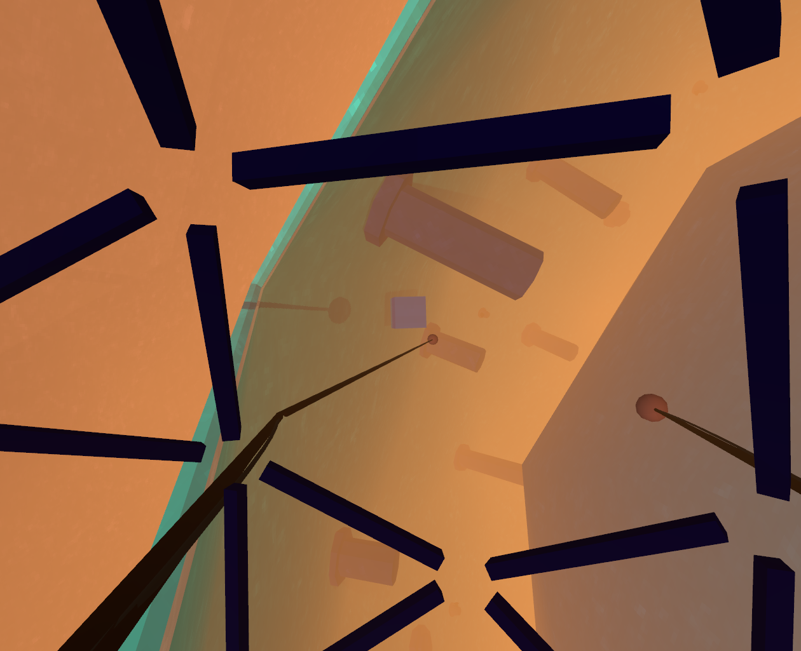

# The Klaxon Threat XI - Vendetta in Stratoverse

Their invasion left us crippled... and now it's time to take the fight to them!




The Klaxon Threat XI - Vendetta in Stratoverse is a VR vehicular game of exploration. Navigating the strange pocket dimension inside your indestructible craft and armed only with robotic arms, your mission is to infiltrate deep into the nested spaces and dismantle the core in the very heart of alien contraption.

The game levels are procedurally generated, different every time.

Created in 14 days for the ManiFest VR game jam. Uses the awesome LÖVR framework. Audio made with Audacity. Prompt Font designed by by Cadson Demak. No AI involvement on this one.

Built binaries available at [game jam](https://j-miskov.itch.io/the-klaxon-threat-xi-vendetta-in-stratoverse) page.

## VR Controls

```
Right thumbstick: rotate
Right trigger: move forward
Left trigger: move backward
Left thumbstick: strafe
Left/right grip: grab object
```

## Debugging desktop controls

```
Right click to pass the intro screen
TFGH to fly around
IJKL to rotate the craft
Space to spawn a barrel
```
